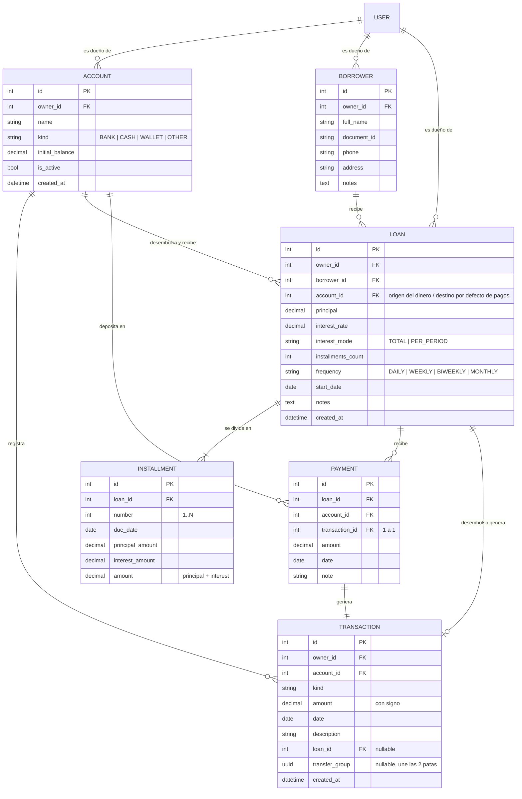
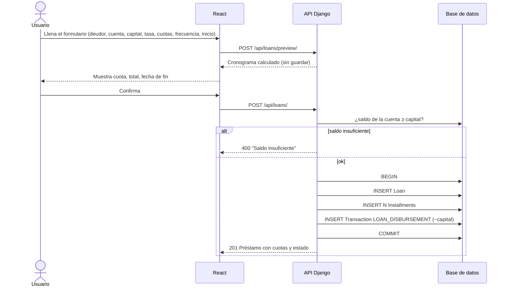
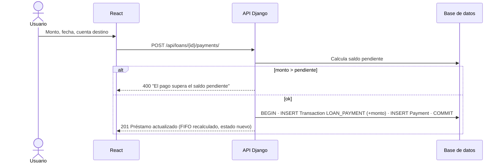
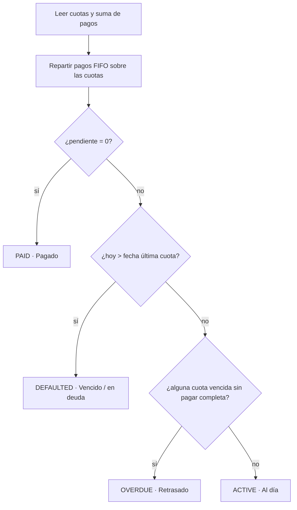

# Soplate — Documento de diseño

> App para un prestamista: controla el dinero repartido en varias cuentas, los préstamos que hace, sus cuotas, su estado y un balance general.

**Fecha:** 2026-10-03
**Stack:** Django 5.2 LTS + Django REST Framework (backend) · React 19 + TypeScript + Vite (frontend) · SQLite en desarrollo (PostgreSQL en producción sin cambios de código).

---

## 1. Qué problema resuelve

Una persona presta dinero. Ese dinero sale de alguna de sus cuentas (banco, efectivo, Nequi…) y vuelve en cuotas a alguna cuenta. Hoy necesita saber, sin hacer cuentas a mano:

1. **Cuánto dinero tiene en cada cuenta** y en total.
2. **Por cada préstamo:** valor de la cuota, fecha de inicio, fecha en que debería terminar, cuánto le deben todavía y el estado (al día, retrasado, vencido o pagado).
3. **Cuánto dinero tendrá en una fecha futura** si los deudores pagan lo que deben pagar.
4. **Un balance general:** dinero disponible + dinero por cobrar, intereses ganados, préstamos por estado.

## 2. Las tres decisiones que ordenan todo el diseño

### 2.1 El saldo de una cuenta **no se guarda, se calcula** (libro contable)

Cada movimiento de dinero es una fila en la tabla `Transaction` con un monto **con signo** (+ entra, − sale). El saldo de una cuenta es:

```
saldo = saldo_inicial + SUMA(transacciones.amount de esa cuenta)
```

**Por qué:** si guardáramos un campo `balance` y lo actualizáramos en cada operación, cualquier error (un pago borrado, una operación a medias) dejaría el saldo desfasado para siempre. Con un libro contable, el saldo *siempre* es la suma de los hechos y se puede auditar movimiento por movimiento. Así funcionan los sistemas contables de verdad.

### 2.2 Las cuotas se generan una sola vez; los pagos se aplican "del más viejo al más nuevo" (FIFO), calculado al vuelo

Cuando se crea un préstamo, el sistema genera su **cronograma** (`Installment`): N cuotas con fecha y monto. Los pagos (`Payment`) se guardan aparte, contra el préstamo, **no contra una cuota específica**. Para saber qué cuotas están pagadas se reparte el total pagado sobre las cuotas en orden de fecha:

```
Cuotas:  [100] [100] [100]      Total pagado: 150
Reparto: [100 ✔] [50 parcial] [0 pendiente]
```

**Por qué:** así se soportan pagos parciales, pagos dobles y pagos adelantados sin lógica especial, y no existe un "pagado" guardado que pueda contradecir a los pagos reales.

### 2.3 El estado del préstamo **se deriva**, no se guarda

| Estado | Código | Regla (evaluada en orden, con la fecha de hoy) |
|---|---|---|
| Pagado / terminado | `PAID` | saldo pendiente = 0 |
| Vencido / en deuda | `DEFAULTED` | hoy > fecha de la última cuota **y** saldo pendiente > 0 |
| Retrasado | `OVERDUE` | existe alguna cuota con fecha < hoy que no está pagada completa |
| Activo / al día | `ACTIVE` | ninguna de las anteriores |

Cada cuota también tiene un estado derivado: `PAID`, `PARTIAL` (pagada en parte y aún no vence), `OVERDUE` (venció sin pagarse completa), `PENDING`.

**Por qué:** el estado depende del tiempo. Un préstamo "activo" hoy puede estar "retrasado" mañana sin que nadie toque la base de datos. Si fuera un campo guardado, haría falta un proceso nocturno para actualizarlo; calculándolo, siempre es correcto.

## 3. Reglas del dominio

### 3.1 Interés (interés simple sobre el capital, "plano")

Es el modelo que usan casi todos los prestamistas informales. Cada préstamo tiene:

- `principal`: capital prestado.
- `interest_rate`: porcentaje (p. ej. `20.00` = 20 %).
- `interest_mode`:
  - `TOTAL`: el porcentaje se aplica **una vez** al capital. *"Te presto 1.000.000 al 20 % en 30 cuotas diarias"* → interés = 200.000.
  - `PER_PERIOD`: el porcentaje se aplica **por cada periodo** (cada cuota). *"Al 10 % mensual por 6 meses"* → interés = 1.000.000 × 10 % × 6 = 600.000.
- `installments_count`: número de cuotas.
- `frequency`: `DAILY` (diaria), `WEEKLY` (semanal), `BIWEEKLY` (quincenal = cada 15 días), `MONTHLY` (mensual).

```
interes_total = principal × tasa/100                       (TOTAL)
interes_total = principal × tasa/100 × installments_count  (PER_PERIOD)
total_a_pagar = principal + interes_total
cuota         = total_a_pagar / installments_count   (redondeada a 2 decimales)
```

**Redondeo:** todas las cuotas valen `cuota` redondeada, menos la **última**, que absorbe la diferencia para que la suma sea exactamente `total_a_pagar`. Lo mismo se aplica por separado a la parte de capital y a la de interés de cada cuota.

**Fechas:** la primera cuota vence un periodo después de `start_date`. La cuota *k* vence en `start_date + k periodos`. Para la frecuencia mensual se usa `relativedelta` (31-ene + 1 mes = 28/29-feb, no 3-mar). La **fecha esperada de fin** es la fecha de la última cuota.

### 3.2 Movimientos de dinero (`Transaction.kind`)

| kind | Signo | Lo crea |
|---|---|---|
| `DEPOSIT` | + | usuario (aporte de dinero propio) |
| `WITHDRAWAL` | − | usuario (retiro para uso personal) |
| `INCOME` | + | usuario (otro ingreso) |
| `EXPENSE` | − | usuario (gasto) |
| `TRANSFER_OUT` / `TRANSFER_IN` | − / + | el endpoint de transferencias (siempre en pareja, en una sola operación atómica) |
| `LOAN_DISBURSEMENT` | − | el sistema, al crear un préstamo |
| `LOAN_PAYMENT` | + | el sistema, al registrar un pago |

El usuario solo envía montos positivos; el backend aplica el signo según el `kind`.

### 3.3 Validaciones de negocio

- No se puede prestar más que el saldo actual de la cuenta de origen.
- No se puede registrar un pago mayor que el saldo pendiente del préstamo.
- No se puede transferir más que el saldo de la cuenta de origen, ni hacia la misma cuenta.
- No se puede borrar una cuenta, deudor o préstamo con movimientos asociados (se responde 400 con un mensaje, no un error 500). Las cuentas se pueden **archivar** (`is_active = false`).
- Todos los montos son `Decimal` con 2 decimales (nunca `float`).

### 3.4 Multiusuario

Cada tabla principal tiene `owner` (el usuario de Django). Toda consulta se filtra por el usuario autenticado: un usuario nunca ve ni modifica los datos de otro (responde 404).

### 3.5 Proyección ("¿cuánto tendré el día X?")

```
proyectado(X) = saldo_actual_total
              + Σ (lo que falta pagar de cada cuota con hoy ≤ fecha ≤ X)
              [+ Σ lo que falta de las cuotas ya vencidas, solo si include_overdue=true]
```

El desglose es por cuenta: el dinero de cada préstamo se espera en la `account` del préstamo. Las cuotas vencidas se muestran aparte porque son dinero "dudoso".

### 3.6 Balance general (dashboard)

- `total_balance`: suma de saldos de las cuentas activas.
- `outstanding_total`: dinero por cobrar (saldo pendiente de préstamos no pagados).
- `outstanding_principal`: parte de capital de lo anterior.
- `interest_earned`: intereses ya cobrados = Σ pagado × (interés_total / total_a_pagar) de cada préstamo.
- `net_worth`: `total_balance + outstanding_total`.
- `loans_by_status`: conteo por estado.
- `upcoming`: cuotas que vencen en los próximos 7 días.
- `overdue`: cuotas vencidas con saldo.

## 4. Diagrama entidad-relación



**Cómo leerlo:**
- `||--o{` = "uno a muchos (puede ser cero)". Una cuenta tiene cero o muchas transacciones.
- `||--|{` = "uno a muchos (al menos uno)". Un préstamo siempre tiene al menos una cuota.
- `||--||` = "uno a uno". Cada pago genera exactamente una transacción.
- Los campos **calculados** (saldo de la cuenta, estado del préstamo, monto pagado de cada cuota) **no aparecen** en el diagrama a propósito: no son columnas.

## 5. Flujos

### 5.1 Crear un préstamo



### 5.2 Registrar un pago



### 5.3 Cálculo del estado de un préstamo (en cada lectura)



### 5.4 Transferencia entre cuentas

`POST /api/transfers/` → en una transacción de base de datos crea `TRANSFER_OUT` (−) en el origen y `TRANSFER_IN` (+) en el destino, unidas por el mismo `transfer_group` (UUID). Si algo falla, no se guarda ninguna de las dos.

## 6. API REST

Todas bajo `/api/`, JSON, autenticación JWT (`Authorization: Bearer <token>`). Los montos viajan como strings decimales (`"1500000.00"`) para no perder precisión.

| Método | Ruta | Descripción |
|---|---|---|
| POST | `auth/token/` | login → `{access, refresh}` |
| POST | `auth/token/refresh/` | renueva el token `access` |
| GET | `me/` | usuario actual |
| GET/POST | `accounts/` | listar (con `balance`) / crear |
| GET/PATCH/DELETE | `accounts/{id}/` | detalle / editar / borrar (400 si tiene movimientos) |
| GET/POST | `transactions/` | listar (filtros `account`, `kind`, `date_from`, `date_to`) / crear manual (solo DEPOSIT, WITHDRAWAL, INCOME, EXPENSE) |
| POST | `transfers/` | transferencia entre cuentas |
| GET/POST | `borrowers/` · GET/PATCH/DELETE `borrowers/{id}/` | deudores |
| POST | `loans/preview/` | cronograma sin guardar |
| GET/POST | `loans/` | listar (filtros `status`, `borrower`) / crear |
| GET/PATCH | `loans/{id}/` | detalle con cuotas, resumen y estado; PATCH solo `notes` |
| GET/POST | `loans/{id}/payments/` | pagos del préstamo |
| GET | `reports/dashboard/` | balance general |
| GET | `reports/projection/?date=YYYY-MM-DD&include_overdue=false` | proyección |

## 7. Pantallas (frontend)

1. **Login.**
2. **Dashboard:** tarjetas (disponible, por cobrar, intereses ganados, patrimonio), saldos por cuenta, préstamos por estado, cuotas próximas y vencidas.
3. **Cuentas:** lista con saldo, crear cuenta, nuevo movimiento, transferir, historial de movimientos por cuenta.
4. **Deudores:** lista y formulario.
5. **Préstamos:** lista con filtro por estado (insignias de colores), formulario con vista previa del cronograma, detalle con cuotas, barra de progreso y formulario de pago.
6. **Proyección:** selector de fecha → saldo proyectado total y por cuenta.

Moneda de visualización: pesos colombianos (`es-CO`, `COP`), configurable en un solo archivo. Zona horaria del backend: `America/Bogota`.

## 8. Fuera de alcance (extensiones naturales, ya previstas por el diseño)

- Interés de mora / recargos por retraso (sería un nuevo tipo de cargo sumado al cronograma).
- Amortización francesa (otra función generadora de cronograma; el resto no cambia).
- Refinanciar / reestructurar préstamos, anular pagos.
- Adjuntar comprobantes, recordatorios por WhatsApp, exportar a Excel.
- Varias monedas.
